<picture>
  <source media="(prefers-color-scheme: dark)" srcset="./assets/header-dark.svg">
  
</picture>

&nbsp;

### Hey, I'm Shiv 👋

I build things that glow. Right now that's **[DeskDot](https://github.com/shivpatel2468/idotmatrix)**, which turns a
32×32 iDotMatrix LED panel into a live desktop companion: clocks that know your calendar, weather for where you are,
a flight radar, games your friends join from their phones, and a mascot that mirrors what your AI agent is doing.

I like the whole stack in one hand: the Bluetooth bytes, the async engine that paces them, the studio you drive it
from, and the last pixel of polish on the panel. 1,024 pixels, no subscriptions.

<picture>
  <source media="(prefers-color-scheme: dark)" srcset="./assets/divider-dark.svg">
  
</picture>

## 🟧 &nbsp;Featured: DeskDot

<table>
<tr>
<td width="42%" valign="top">

</td>
<td valign="top">

**The all-in-one app for your iDotMatrix.** One async Python engine owns the panel's Bluetooth link, a React studio
drives it from any browser or phone, and an MCP server lets agents like Claude see the panel and draw on it.

- 🖼️ **116 apps** on 70+ free live data sources: weather, flights, quakes, markets, space, sports
- 🎮 **25 games**, 21 multiplayer: friends scan a QR code and their phone becomes the controller
- 🎰 **Casino night** with provably-fair rounds and a luxury table on the TV
- 🪰 **A fruit-fly brain** modelled on the FlyWire connectome that sees the pixels and plays
- 🤖 **21 MCP tools** for AI agents · 📦 Windows, macOS and Android installers with in-app updates

[**Download 3.8.0**](https://github.com/shivpatel2468/idotmatrix/releases/latest) ·
[**Try it in Chrome**](https://idotmatrix.com/app/) ·
[What's new](https://github.com/shivpatel2468/idotmatrix/blob/main/WHATS_NEW.md) ·
[idotmatrix.com](https://idotmatrix.com)

</td>
</tr>
</table>

<picture>
  <source media="(prefers-color-scheme: dark)" srcset="./assets/reels-dark.svg">
  
</picture>

## 🛠️ &nbsp;Currently building

- ⌚ **DeskDot on the wrist:** a Wear OS version for the watch
- 📜 **Living specs:** documentation that moves with the code, for people and AI agents alike
- ✨ **Polish, always:** the Liquid-Glass studio and its 21 light and dark page themes keep getting smoother

## 🧰 &nbsp;Toolbox

<picture>
  <source media="(prefers-color-scheme: dark)" srcset="https://skillicons.dev/icons?i=py%2Cfastapi%2Cts%2Creact%2Ctailwind%2Cvite%2Ckotlin%2Cjava%2Candroidstudio%2Cswift%2Craspberrypi%2Cgithubactions%2Cnetlify&perline=13&theme=dark">
  
</picture>

`Bluetooth LE` · `Web Bluetooth` · `asyncio` · `pydantic` · `MCP` · `Pillow` · `NumPy` · `PyInstaller` · `Inno Setup`

## 📦 &nbsp;More on GitHub

## 📊 &nbsp;Activity

<picture>
  <source media="(prefers-color-scheme: dark)" srcset="https://streak-stats.demolab.com/?user=shivpatel2468&background=0a090d&border=2a2531&stroke=2a2531&ring=ff3f78&fire=ffcc33&currStreakNum=f5f3f7&sideNums=f5f3f7&currStreakLabel=ffcc33&sideLabels=a19cab&dates=6d6878&border_radius=18">
  
</picture>

<picture>
  <source media="(prefers-color-scheme: dark)" srcset="https://raw.githubusercontent.com/shivpatel2468/shivpatel2468/output/snake-dark.svg">
  
</picture>

<picture>
  <source media="(prefers-color-scheme: dark)" srcset="./assets/ticker-dark.svg">
  
</picture>

